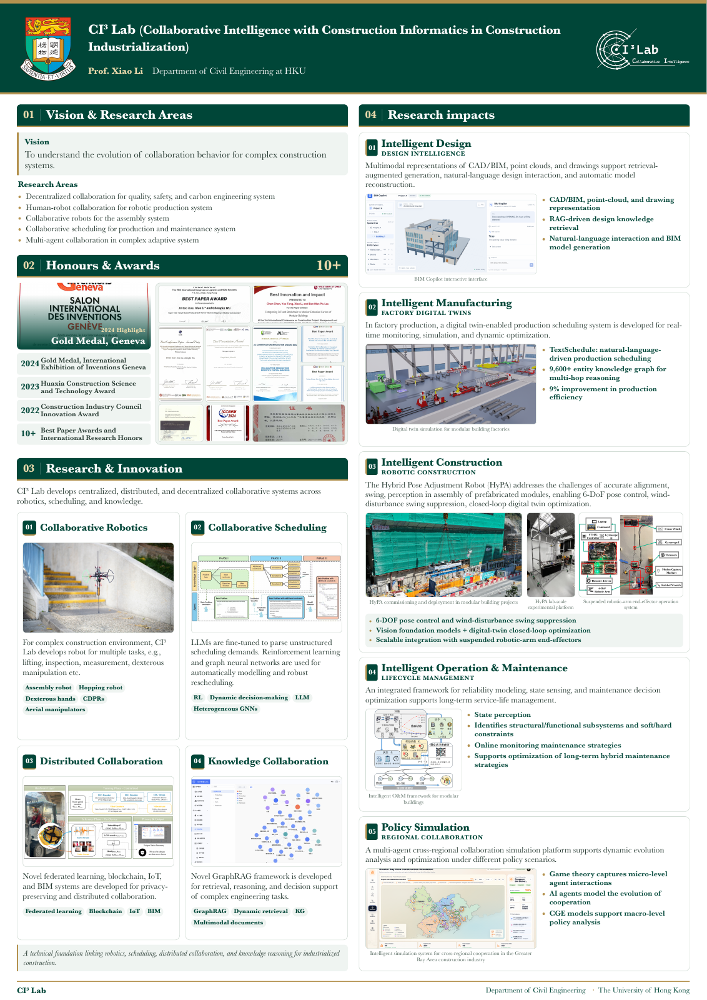

# CI³ Lab Research Poster

An English A0 portrait poster for CI³ Lab, Department of Civil Engineering, The University of Hong Kong. The layout uses two columns, Baskerville typography, and four selectable colour palettes.



## Open the poster offline

Download **[CI3-Lab-Poster-Offline.html](exports/CI3-Lab-Poster-Offline.html)** and open the downloaded file in a browser. All images, styles and JavaScript are embedded. No server or internet connection is required.

The toolbar offers four palettes, full-size viewing, and **Print / Save PDF**. Printing uses the selected palette and an A0 portrait page (841 × 1189 mm). A ready-made green-and-gold **[A0 PDF](exports/CI3-Lab-Research-Poster-A0.pdf)** is also included.

Baskerville uses the font installed on the viewing computer. The source provides serif fallbacks for computers without Baskerville; the included PDF preserves the exported typography.

## Content

1. Vision & Research Areas
2. Honours & Awards
3. Research & Innovation
4. Research impacts

Research impacts directly presents five application cards. The redundant introductory label and process strip have been removed. The poster retains the supplied English copy and original image files, with image-specific display crops and aligned frames.

This repository contains only the poster and its required assets. It does not contain the brochure pages, brochure PDFs, unrelated images, or hosting configuration.

## Edit and build

Use Node.js 22.12 or newer.

```sh
npm ci
npm run dev
```

```sh
npm run build
npm run package:offline
```

The second command creates the self-contained HTML in `exports/`.

| File | Purpose |
| --- | --- |
| `src/Poster.vue` | Poster structure, palette controls and print interaction |
| `src/posterContent.js` | English content and asset references |
| `src/poster.css` | Baskerville styling, image crops, layout and A0 print rules |
| `assets/logos/` | 2 institutional/lab logos |
| `assets/awards/` | 11 award images |
| `assets/research/` | 4 research images |
| `assets/impacts/` | 7 application images |
| `assets/manifest.json` | File sizes and SHA-256 checksums for all 24 original assets |

## Verification

```sh
npx playwright install chromium
npm run verify:offline
```

Alternatively, set `CHROME_EXECUTABLE` to an installed Chrome executable. The check opens the standalone file with networking disabled, verifies all 24 images, actual Baskerville rendering, aligned research image frames, palette persistence, unchanged text across palettes, responsive preview, and one-page A0 PDF output. Font checks require Baskerville to be installed.

Original imagery is retained at its supplied resolution, so the standalone HTML and PDF are relatively large.
